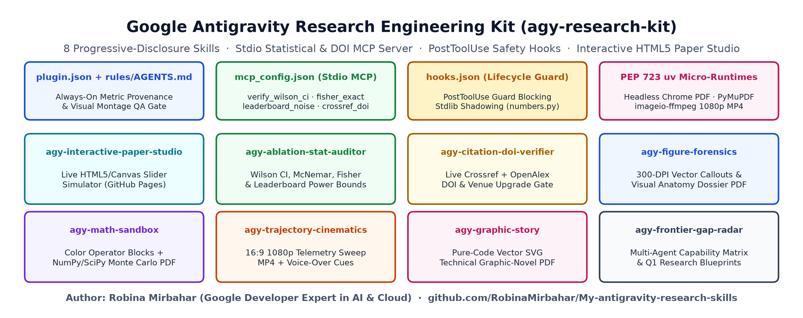

# Google Antigravity Research Engineering Kit (`My-antigravity-research-skills`)


> **Author & Architect:** [Robina Mirbahar](https://github.com/RobinaMirbahar) (Google Developer Expert in AI & Cloud)  
> **Focus:** Native Google Antigravity Research Skills (`SKILL.md`), Statistical & Crossref DOI MCP Server (`mcp_config.json`), Lifecycle Safety Hooks (`hooks.json`), and Interactive HTML5 Paper Studios (`docs/index.html`)

---

## Why I Built `My-antigravity-research-skills`

Reading, auditing, and communicating dense AI and systems research papers shouldn't stop at plain-text chat summaries—or fragile TeX scripts that fail on half of developer laptops.

**Google Antigravity** introduces five composable customization primitives—**Progressive-Disclosure Skills (`SKILL.md`)**, **Always-On Rules (`rules/AGENTS.md`)**, **Model Context Protocol Servers (`mcp_config.json`)**, **Lifecycle Event Hooks (`hooks.json`)**, and **Generative Interactive UIs**—that let an AI agent act as a rigorous research engineering co-pilot.

This repository packages my **8-skill `agy-research-kit` plugin**, a **zero-setup PEP 723 Stdio MCP Server** for exact statistical & DOI verification, and a **live HTML5 Interactive Paper Simulator**:



---

## Architecture: The 8 Antigravity Research Skills (`skills/`)

Unlike static prompt templates, each skill stays idle at `~50 tokens` (YAML frontmatter only) until activated on demand, and pairs with deterministic `uv run` PEP 723 micro-environments:

| Skill Directory | Engineering Capability | Output Artifact(s) |
| :--- | :--- | :--- |
| **[`agy-interactive-paper-studio`](skills/agy-interactive-paper-studio/SKILL.md)** | Converts a paper's closed-form equations & thresholds into a 60-FPS HTML5/Canvas parameter simulator with preset operating points. | Single-file `index.html` (GitHub Pages / Generative UI ready) |
| **[`agy-ablation-stat-auditor`](skills/agy-ablation-stat-auditor/SKILL.md)** | Recomputes exact **Wilson 95% score CIs**, **McNemar paired tests**, **Fisher's Exact p-values**, and small-leaderboard **Winner's Curse** power bounds. | Markdown/LaTeX Statistical Audit Table + JSON |
| **[`agy-citation-doi-verifier`](skills/agy-citation-doi-verifier/SKILL.md)** | Audits `.bib` / Markdown references against live **Crossref & OpenAlex APIs**, upgrades preprints to peer-reviewed venues, and flags mismatches. | Traffic-Light Bibliography Audit Report |
| **[`agy-figure-forensics`](skills/agy-figure-forensics/SKILL.md)** | Overlays numbered vector callouts, regime shading, **Visual Anatomy** decode steps, and **Engineering Takeaway** cards onto 300-DPI paper plots. | A4 Visual Anatomy PDF + PyMuPDF QA Montage |
| **[`agy-math-sandbox`](skills/agy-math-sandbox/SKILL.md)** | Decomposes propositions into color-coded operator pills, runs `verify_math.py` Monte Carlo checks, and plots parameter sensitivity curves. | A4 Math Verification PDF + `eq_verified_numbers.json` |
| **[`agy-trajectory-cinematics`](skills/agy-trajectory-cinematics/SKILL.md)** | Encodes broadcast-clean **1920x1080 H.264 `.mp4`** animations via portable `imageio[ffmpeg]` with synchronized 2x2 telemetry plots. | 1080p `.mp4` + PEP 723 `.py` + Narration `.md` |
| **[`agy-graphic-story`](skills/agy-graphic-story/SKILL.md)** | Renders pure-code A4 vector SVG technical graphic novels complete with architectural blackboards, decision gates, and verbatim scoreboards. | A4 Vector Graphic-Novel PDF |
| **[`agy-frontier-gap-radar`](skills/agy-frontier-gap-radar/SKILL.md)** | Synthesizes 18–25 recent papers via OpenAlex/arXiv into an `N x 7` capability heatmap, blind-spot table, and novelty-checked Q1 blueprints. | A4 Frontier Gap Radar & Blueprint PDF |

---

## Bundled Stdio MCP Server & Lifecycle Safety Hook (`plugins/agy-research-kit/`)

Installing the full `agy-research-kit` plugin activates three extra runtime layers automatically:

1. **Statistical & DOI Audit MCP Server ([`mcp/research_audit_mcp.py`](plugins/agy-research-kit/mcp/research_audit_mcp.py))**:
   - `verify_wilson_ci(successes, total, confidence)` — Exact non-asymptotic Wilson score interval.
   - `verify_fisher_exact(k_method, n_method, k_baseline, n_baseline)` — Exact 2x2 contingency test.
   - `leaderboard_noise_floor(num_tasks, baseline_rate)` — Standard error and 80%-power minimum detectable lift.
   - `verify_doi_metadata(doi)` — Live Crossref REST verification returning peer-reviewed venue metadata.
2. **Stdlib-Shadowing Guard Hook ([`hooks/stdlib_shadow_guard.py`](plugins/agy-research-kit/hooks/stdlib_shadow_guard.py))**:
   - Triggered via [`hooks.json`](plugins/agy-research-kit/hooks.json) on `PostToolUse` (`write_file`) to block accidental creation of `numbers.py`, `math.py`, or `statistics.py` files that break `numpy`/`scipy` imports.
3. **Always-On Provenance & Montage QA Rules ([`rules/AGENTS.md`](plugins/agy-research-kit/rules/AGENTS.md))**:
   - Enforces verbatim metric provenance and mandatory PyMuPDF visual montage checks before artifact delivery.

---

## Quick Install in Google Antigravity

### Option A: Install Full Plugin Bundle (Skills + MCP Server + Hooks + Rules)

**Windows (PowerShell):**
```powershell
git clone https://github.com/RobinaMirbahar/My-antigravity-research-skills.git
New-Item -ItemType Directory -Force -Path "$HOME\.gemini\config\plugins" | Out-Null
Copy-Item -Recurse -Force My-antigravity-research-skills\plugins\agy-research-kit "$HOME\.gemini\config\plugins\"
```

**macOS / Linux:**
```bash
git clone https://github.com/RobinaMirbahar/My-antigravity-research-skills.git
mkdir -p ~/.gemini/config/plugins
cp -r My-antigravity-research-skills/plugins/agy-research-kit ~/.gemini/config/plugins/
```

### Option B: Install Standalone Skills Globally (`~/.gemini/config/skills/`)

```bash
mkdir -p ~/.gemini/config/skills
cp -r My-antigravity-research-skills/skills/* ~/.gemini/config/skills/
```

---

## Live Interactive Studio & End-to-End Case Study

Explore the live outputs generated by `agy-research-kit` in [`docs/index.html`](docs/index.html) and [`examples/gemma4-loop-breaker/`](examples/gemma4-loop-breaker/):

- **[`docs/index.html`](docs/index.html)** — Zero-dependency HTML5/Canvas **W4A16 Softmax Dilution & LoopBreaker Simulator** (`agy-interactive-paper-studio`).
- **[`Gemma4_LoopBreaker_Figure_Guide_v1.pdf`](examples/gemma4-loop-breaker/Gemma4_LoopBreaker_Figure_Guide_v1.pdf)** — Annotated 300-DPI Visual Anatomy Dossier (`agy-figure-forensics`).
- **[`Gemma4_LoopBreaker_Equation_Guide_v1.pdf`](examples/gemma4-loop-breaker/Gemma4_LoopBreaker_Equation_Guide_v1.pdf)** + **[`eq_verified_numbers.json`](examples/gemma4-loop-breaker/eq_verified_numbers.json)** — Operator-highlighted math verification & simulation check (`agy-math-sandbox` + `agy-ablation-stat-auditor`).
- **[`Gemma4_LoopBreaker_Explainer_v1.mp4`](examples/gemma4-loop-breaker/Gemma4_LoopBreaker_Explainer_v1.mp4)** — 1920x1080 H.264 live KV-cache & softmax dilution trajectory sweep (`agy-trajectory-cinematics`).
- **[`Gemma4_LoopBreaker_Comic_v1.pdf`](examples/gemma4-loop-breaker/Gemma4_LoopBreaker_Comic_v1.pdf)** — 4-page A4 vector SVG technical graphic story (`agy-graphic-story`).

---

## Verification Suite (`uv run`)

Validate all 8 skill manifests, MCP JSON-RPC tool execution, hook guards, and generated artifacts in one command:

```bash
uv run tests/test_skills_structure.py
```

---

## License

Released under the [MIT License](LICENSE) · Authored by [Robina Mirbahar](https://github.com/RobinaMirbahar).

---

### Official Google Developer Resources
- [Google Antigravity Documentation](https://antigravity.google/?utm_campaign=deveco_gdemembers&utm_source=deveco)
